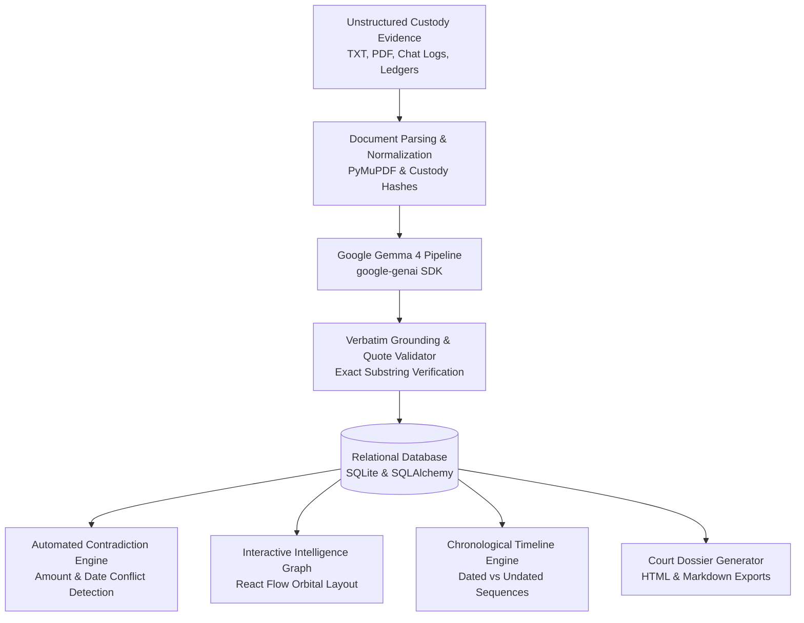

# EvidenceOS — AI-Powered Digital Evidence Intelligence Platform

<p align="center">
  
  
  
  
  
  
</p>

---

## Executive Summary

**EvidenceOS** is an open, enterprise-grade forensic intelligence platform designed for law enforcement, corporate compliance auditors, and digital forensics examiners. It converts chaotic, unstructured digital evidence collections—including intercepted encrypted chat logs, forensic PDF incident reports, offshore bank ledgers, and witness interview transcripts—into **rigorously grounded, court-admissible intelligence**.

Powered by **Google Gemma 4** (`gemma-4-26b-a4b-it`) via the official **Google GenAI Python SDK (`google-genai`)**, EvidenceOS bridges the critical gap between powerful LLM reasoning and the non-negotiable evidentiary standards of legal custody: **Zero Unverified Hallucinations, 100% Verbatim Quote Grounding, Automated Contradiction Detection, and Complete Chain of Custody Traceability.**

---

## The Evidentiary Challenge & Solution

| The Investigation Problem | How EvidenceOS Solves It |
| :--- | :--- |
| **Document Overload**: Forensic collections often contain hundreds of pages across heterogeneous formats (PDFs, plain text dumps, transcripts). | High-throughput parsing via PyMuPDF and UTF-8 stream normalization with byte integrity checks and page-level provenance. |
| **LLM Hallucinations**: Standard AI assistants summarize documents but synthesize "facts" or mix up figures that fail judicial scrutiny. | **Verbatim Grounding Engine**: Every entity, event, claim, and relationship must link to an exact raw text quote substring, or it is flagged for human review. |
| **Hidden Contradictions**: Key discrepancies (e.g., a $45,000 chat extortion demand vs a $55,000 offshore wire transfer) remain buried across disparate files. | **Automated Contradiction Engine**: Discovers conflicting financial amounts, mutually exclusive date timelines, and contradictory witness statements side-by-side. |
| **Opaque Linkages**: Relationships between phone numbers, anonymous handles, and corporate executives are difficult to conceptualize. | **Interactive Intelligence Graph**: React Flow canvas with orbital positioning, color-coded entity taxonomy, animated edge flows, and click-to-inspect quote dossiers. |
| **Reporting Burden**: Compiling formal forensic reports takes days of manual transcription and citation. | **Court-Ready Export**: Generates standardized Markdown (`.md`) and styled HTML (`.html`) investigation dossiers with legal notices in one click. |

---

## Core Capabilities



### 1. 100% Verbatim Source Quotation Grounding
EvidenceOS enforces a strict anti-hallucination policy. Every extracted entity, event, and claim is verified against the raw text of the uploaded evidence:
- **Substring Match Validation**: Quotes must match source text verbatim.
- **Review Flagging**: If Gemma 4 extracts an entity or claim where the quote cannot be verified with 100% fidelity, the system automatically assigns `needs_review: true` with an amber warning pill.
- **Inspectable Provenance**: Clicking any node or claim displays the exact raw quote and evidence file ID in a sliding dossier drawer.

### 2. Multi-Class Entity Intelligence Graph
Built on top of React Flow (`@xyflow/react`) with custom dark-mode nodes:
- **Entity Taxonomy**: Visual categorization for `Person` (Sky), `Username` (Purple), `Phone` (Emerald), `Email` (Amber), `Organization` (Blue), `Location` (Rose), and `Financial Account` (Teal).
- **Orbital Relationship Layout**: Automatic radial distribution connecting central figures to their communications and accounts.
- **Animated Flow Lines**: Active edges feature subtle animated dash-flows indicating directionality of funds, communications, or commands.

### 3. Chronological Timeline Reconstruction
EvidenceOS reconstructs the sequence of events without conflating stated dates with unanchored claims:
- **Chronological Sequence**: Dated events are chronologically sorted with date badges, event indices, and involved entities.
- **Undated Occurrences**: Kept in a dedicated section with provenance indicators so investigators know which events lack explicit date anchors.

### 4. Automated Contradiction & Discrepancy Engine
Cross-examines evidence across different documents to surface irreconcilable statements:
- **Amount Discrepancies**: Compares transaction amounts across witness statements, chat negotiations, and bank ledgers.
- **Date Conflicts**: Flags impossible timelines where participants claim to be in different locations or execute actions out of order.
- **Side-by-Side Comparison**: Displays `Source Record 1` vs `Source Record 2` side-by-side.
- **Investigator Adjudication**: Investigators can record resolution notes directly in the platform and update status (`Active Conflict` $\to$ `Resolved`).

### 5. Instant Evaluation Mode (Synthetic Demo Case)
Judges and evaluators can test the entire platform in seconds without providing files or API keys:
- The **Operation Chimera Leak** demo preloads 4 realistic synthetic forensic documents.
- Includes a built-in baseline evaluation mode that runs offline or live GenAI via `GEMINI_API_KEY`.

---

## Walkthrough: "Operation Chimera Leak" Demonstration Case

The repository includes a complete synthetic investigation dataset representing an insider threat and corporate genetic IP exfiltration incident:

1. **`evidence_01_chat_log.txt` (Telegram Session Excerpt)**:
   - Encrypted communication between `shadow42` and `Dr. Aris Thorne`.
   - Mentions a Zurich drop, a Swiss backup phone `+41 22 901 4400`, and an agreed installment of **$45,000**.
2. **`evidence_02_bank_ledger.txt` & `.pdf` (Offshore Wire Ledger)**:
   - Nexus Financial Services wire transfer from account `ACC-88910` to `Dr. Aris Thorne`.
   - Amount: **$55,000** (conflicts with the $45,000 chat agreement).
   - Notes director authorization reference attributed to `Marcus Baxter`.
3. **`evidence_03_incident_report.txt` (Apex BioTech SOC Escalation)**:
   - 4.2 GB data exfiltration detected at the Geneva Facility.
   - Shows keycard override granted by `Marcus Baxter` on the evening of October 12, 2026.
4. **`evidence_04_witness_interview.txt` (Marcus Baxter Sworn Deposition)**:
   - Sworn testimony claiming the wire transfer authorization was forged.
   - Baxter claims Thorne reported an extortion demand of **$45,000** by `shadow42`, but denies ever authorizing any payout or $55,000 transfer.

### The AI Intelligence Output
When Gemma 4 analyzes these custody files, EvidenceOS automatically:
- Maps **6+ entities** across 3 organizations, 2 phone/email identifiers, and 2 accounts.
- Reconstructs a **chronological timeline** from October 11 to October 16, 2026.
- Detects the **$45,000 vs. $55,000 wire transfer contradiction**.
- Verifies all claims against the original documents with verbatim quote grounding.

---

## Technology Stack

### Frontend Architecture
- **Framework**: [Next.js 16 (App Router)](https://nextjs.org/) with React 19 and Turbopack compiler.
- **Language**: TypeScript (Strict Mode).
- **Styling**: Tailwind CSS v4 with custom dark aesthetic (`#080d1a` background, `#0e1526` surface, `#121c33` card, `#1e2b48` border).
- **Typography**: Google Fonts (`Inter` for primary UI, `JetBrains Mono` for evidence hashes, IDs, and verbatim quotes).
- **Graph Engine**: [`@xyflow/react`](https://reactflow.dev/) (React Flow) with custom nodes, controls, and minimap.
- **Icons**: [`lucide-react`](https://lucide.dev/).

### Backend Architecture
- **Framework**: [FastAPI](https://fastapi.tiangolo.com/) with async ASGI architecture.
- **Server**: [Uvicorn](https://www.uvicorn.org/).
- **AI Integration**: Official [`google-genai`](https://pypi.org/project/google-genai/) Python SDK.
- **Document Ingestion**: [PyMuPDF (`pymupdf`)](https://pymupdf.readthedocs.io/) for high-fidelity PDF extraction and UTF-8 stream normalization.
- **Database**: SQLite with [SQLAlchemy 2.0](https://www.sqlalchemy.org/) ORM.
- **Validation**: [Pydantic v2](https://docs.pydantic.dev/) schemas for strict JSON model extraction and API validation.
- **Testing**: [Pytest](https://docs.pytest.org/) with HTTPX TestClient.

---

## Project Structure

```text
EvidenceOS/
├── frontend/                              # Next.js 16 Web Application
│   ├── app/
│   │   ├── layout.tsx                     # Root layout with Inter & JetBrains Mono fonts
│   │   ├── globals.css                    # Tailwind v4 theme, glassmorphism, React Flow styles
│   │   ├── page.tsx                       # Landing page with ambient glow & quick redirect
│   │   ├── dashboard/page.tsx             # Intelligence Operations Dashboard & metrics
│   │   └── investigations/
│   │       ├── page.tsx                   # Investigations directory & case search
│   │       └── [id]/page.tsx              # Core Investigation Workspace (Graph, Timeline, etc.)
│   ├── components/
│   │   ├── layout/                        # Sidebar & Header with live backend health monitor
│   │   ├── evidence/                      # UploadModal (with 1-click sample loader) & EvidenceFileList
│   │   ├── intelligence/                  # IntelligenceGraph, EntitiesTable, EventsTimeline,
│   │   │                                  # ContradictionsPanel, ClaimsList, RelationshipsList
│   │   └── reports/                       # ReportView with Markdown & HTML export
│   ├── lib/
│   │   ├── api.ts                         # Typed API client with error handling
│   │   └── types.ts                       # Shared TypeScript interfaces
│   ├── package.json
│   └── tsconfig.json
│
├── backend/                               # FastAPI Application & AI Pipeline
│   ├── app/
│   │   ├── main.py                        # FastAPI entrypoint with CORS middleware
│   │   ├── config.py                      # App configuration & environment loader
│   │   ├── database.py                    # SQLite engine and session factory
│   │   ├── models.py                      # Relational ORM models
│   │   ├── schemas.py                     # Pydantic v2 validation models
│   │   ├── api/
│   │   │   ├── investigations.py          # Case CRUD, graph data, timeline, contradictions
│   │   │   ├── evidence.py                # File upload, size validation, text extraction
│   │   │   ├── analysis.py                # Gemma 4 analysis & grounding execution pipeline
│   │   │   └── reports.py                 # Dossier export endpoints (.md and .html)
│   │   └── services/
│   │       ├── gemma.py                   # Gemma 4 integration via google-genai SDK
│   │       ├── document_parser.py         # PyMuPDF and UTF-8 text parser
│   │       ├── validation.py              # Exact substring quote grounding validator
│   │       ├── graph.py                   # Orbital graph layout builder
│   │       ├── contradictions.py          # Cross-document contradiction analyzer
│   │       └── report.py                  # Standardized dossier formatting service
│   ├── tests/
│   │   └── test_backend.py                # 11 comprehensive automated tests
│   ├── uploads/                           # Local custody file storage
│   ├── requirements.txt
│   └── .env.example
│
├── sample-data/                           # Synthetic Demonstration Forensic Evidence Files
│   ├── evidence_01_chat_log.txt           # Intercepted encrypted chat ($45,000 claim)
│   ├── evidence_02_bank_ledger.txt        # Wire transfer ledger ($55,000 conflict)
│   ├── evidence_02_bank_ledger.pdf        # High-fidelity PDF format of bank ledger
│   ├── evidence_03_incident_report.txt    # Apex BioTech network gateway breach log
│   └── evidence_04_witness_interview.txt  # Marcus Baxter sworn witness deposition
│
├── README.md
└── .gitignore
```

---

## Installation & Quickstart

### Prerequisites
- **Python**: Version 3.11 or higher
- **Node.js**: Version 18.18 or higher (Node 20+ recommended)
- **Git**

---

### Step 1: Clone the Repository
```bash
git clone https://github.com/adityatomar4877-rgb/EvidenceOS.git
cd EvidenceOS
```

---

### Step 2: Backend Setup

#### On Windows (PowerShell):
```powershell
cd backend

# If virtual environment is already present, activate it:
.\venv\Scripts\Activate.ps1

# Or create a new virtual environment:
# python -m venv venv
# .\venv\Scripts\Activate.ps1
# pip install -r requirements.txt

# (Optional) Set your Gemini API key for live Gemma 4 extraction:
$env:GEMINI_API_KEY="your-gemini-api-key-here"

# Start FastAPI server:
uvicorn app.main:app --reload --port 8000
```

#### On Linux / macOS (Bash):
```bash
cd backend
python3 -m venv venv
source venv/bin/activate
pip install -r requirements.txt

# (Optional) Set your Gemini API key:
export GEMINI_API_KEY="your-gemini-api-key-here"

# Start FastAPI server:
uvicorn app.main:app --reload --port 8000
```

Backend will be live at: `http://localhost:8000`  
Interactive Swagger API docs: `http://localhost:8000/docs`  
Health check: `http://localhost:8000/api/health`

---

### Step 3: Frontend Setup

Open a separate terminal:
```bash
cd frontend

# Install dependencies
npm install

# Start development server
npm run dev
```

Frontend will be live at: **`http://localhost:3000`**

---

## Live Demonstration Guide

Follow these steps for an end-to-end evaluation:

1. **Access the Console**: Open `http://localhost:3000` in your browser.
2. **Launch Synthetic Case**: Click **"Launch Chimera Leak Demo"** on the hero banner.
3. **Upload Custody Files**:
   - In the workspace header, click **"Upload Evidence"**.
   - Click **"Load 4 Samples"** to automatically ingest the pre-packaged synthetic files in 1 click.
4. **Run Gemma 4 Intelligence Extraction**:
   - Click the gradient button: **"Run Gemma 4 Analysis"**.
   - Watch Gemma 4 extract grounded entities, events, claims, and relationships.
5. **Explore Intelligence Views**:
   - **Intelligence Graph**: Pan and zoom around the orbital network. Click any entity node to inspect its verbatim quotations and provenance.
   - **Entities**: Search or filter across entity categories (Persons, Financial Accounts, Usernames, etc.).
   - **Timeline**: Review chronological sequence of events reconstructed from documents.
   - **Contradictions**: Review the detected **$45K vs. $55K wire discrepancy**. Click **"Resolve Conflict"** to add investigator notes.
   - **Report Export**: Click **"Export HTML Report"** or **"Download .MD"** to produce court-ready investigative packages.

---

## Automated Test Suite

EvidenceOS includes an automated test suite verifying all critical components:

```powershell
cd backend
$env:PYTHONPATH="."
.\venv\Scripts\python.exe -m pytest -v tests/
```

### Test Suite Execution Output
```text
tests/test_backend.py::test_health_check PASSED                          [  9%]
tests/test_backend.py::test_create_and_get_investigation PASSED          [ 18%]
tests/test_backend.py::test_txt_parsing PASSED                           [ 27%]
tests/test_backend.py::test_pdf_parsing PASSED                           [ 36%]
tests/test_backend.py::test_invalid_file_extension PASSED                [ 45%]
tests/test_backend.py::test_source_quote_verification PASSED             [ 54%]
tests/test_backend.py::test_grounding_validation PASSED                  [ 63%]
tests/test_backend.py::test_contradiction_detection PASSED               [ 72%]
tests/test_backend.py::test_graph_generation PASSED                      [ 81%]
tests/test_backend.py::test_report_generation PASSED                     [ 90%]
tests/test_backend.py::test_upload_and_analyze_workflow PASSED           [100%]

======================= 11 passed in 1.12s ========================
```

---

## REST API Reference

| Method | Endpoint | Description |
| :--- | :--- | :--- |
| `GET` | `/api/health` | Returns backend operational health, configured model, and execution mode. |
| `GET` | `/api/investigations` | Lists all investigations with aggregate file, entity, and contradiction stats. |
| `POST` | `/api/investigations` | Creates a new investigation workspace. |
| `GET` | `/api/investigations/{id}` | Retrieves full investigation details, evidence files, entities, and events. |
| `DELETE`| `/api/investigations/{id}` | Permanently deletes an investigation and its associated custody files. |
| `POST` | `/api/investigations/{id}/evidence` | Uploads `.txt` or `.pdf` files, enforces 10 MB limit, and extracts raw text. |
| `GET` | `/api/investigations/{id}/evidence/{file_id}` | Retrieves full extracted text and metadata for a specific evidence file. |
| `POST` | `/api/investigations/{id}/analyze` | Runs Gemma 4 structured extraction, quote validation, and conflict detection. |
| `GET` | `/api/investigations/{id}/graph` | Generates nodes and edges formatted for React Flow canvas display. |
| `POST` | `/api/investigations/{id}/contradictions/{c_id}/resolve` | Updates contradiction status (`resolved`/`unresolved`) with resolution notes. |
| `GET` | `/api/investigations/{id}/reports/markdown` | Downloads court-formatted Markdown dossier (`.md`). |
| `GET` | `/api/investigations/{id}/reports/html` | Downloads standalone styled HTML report (`.html`). |

---

## Responsible AI & Judicial Guardrails

Digital evidence analysis requires strict safety mechanisms:

1. **Source Provenance First**:
   - The platform never asserts an AI inference as established fact without linking to raw source quotes.
   - Any assertion lacking direct verbatim verification is flagged with `needs_review: true`.
2. **Untrusted Document Isolation**:
   - Custody files are parsed purely as text/binary streams. Scripts, embedded macros, or active payloads within PDFs are discarded without execution.
3. **API Key Security**:
   - GenAI API keys are isolated exclusively on the FastAPI backend and are never transmitted to client browsers.
4. **Mandatory Human-in-the-Loop Notices**:
   - All exported investigation reports include prominent legal notices clarifying that automated findings require independent human investigator verification before being submitted as judicial evidence.

---

## License

This project is licensed under the Apache License 2.0. See [LICENSE](LICENSE) for details.
